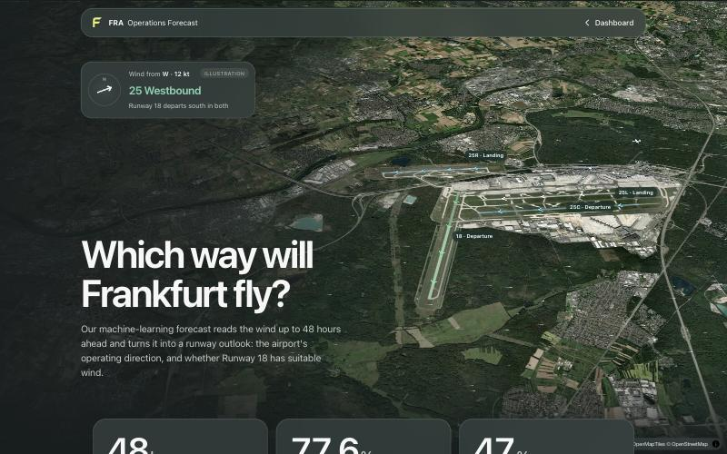
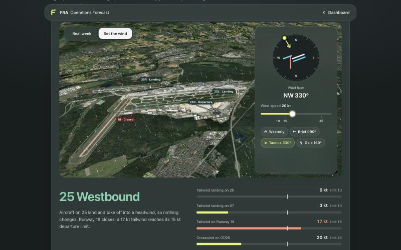
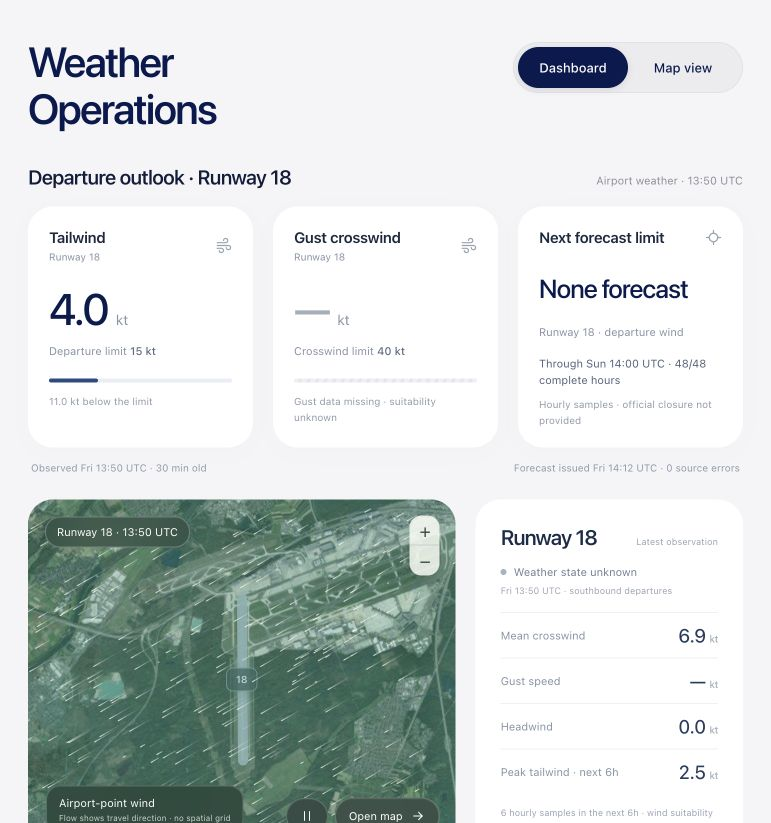

# FRA Operations Forecast

**48-hour decision support for Frankfurt Airport's operating direction (Betriebsrichtung, BR 07 Ost / BR 25 West) and Startbahn 18 West departure weather.** Built for, and winner of, the FraAlliance challenge at AI Week Frankfurt, 30 October 2026.

**Live demo:** [fra-operations-forecast.vercel.app](https://fra-operations-forecast.vercel.app)

- **[How our ML works](https://fra-operations-forecast.vercel.app/how-it-works):** the model explained on a 3D view of the airport.
- **[Set the wind yourself](https://fra-operations-forecast.vercel.app/how-it-works#set-the-wind):** turn the wind and watch the runways respond.



## Why it matters

DFS decides the operating direction; this project does not replace that decision. It gives hub planners at Fraport and Lufthansa an earlier, quantified outlook for:

- departure-runway and SID planning ahead of TOBT/TSAT;
- turnaround and staffing;
- Runway 18 restriction windows.

It also gives noise and community stakeholders a measured, hourly complement to the public 8-hour [UNH Betriebsrichtungsprognose](https://www.umwelthaus.org/fluglaerm/anwendungen-service/aktuelle-betriebsrichtung-und-prognose/).

## What it forecasts, every hour to t+48 h

| Output | How | Status |
| --- | --- | --- |
| Betriebsrichtung 07/25 with certainty | Two blended logistic classifiers on forecast and recent DWD wind, trained on 182 days of observed direction | Learned, provisional labels, uncalibrated |
| Startbahn 18 West weather usability | Challenge rules (15 kt tailwind, 40 kt crosswind) on a corrected wind with residual sampling | Provisional; too few rare events to prove skill |
| Next probable BR change | Hourly class crossings | Hourly window; exact switch time not yet validated |
| Wind and temperature | ICON-D2 / ICON-EU, **corrected every hour by learning from our own past errors** | Implemented and measured |

## Measured results

All results are out of sample, at 1-, 6- and 24-hour leads.

- **Operating direction:** at 1 h, accuracy against the observed direction is 78.5%, against 71.9% for the challenge rule baseline. The two are close at 6 h and tie at 24 h. Probability error (Brier score) is 25.8% lower across 1–48 h. Source: the [model card](docs/model-card.md) and [ML report](docs/ml-improvement.md).
- **Wind:** the hourly online learner cuts wind vector error by 32% at 1 h, 36% at 6 h and 31% at 24 h. Vector RMSE falls from 4.23 / 4.49 / 4.52 kt to 2.86 / 2.88 / 3.12 kt, and wind-speed error roughly halves. Each forecast is corrected only with errors measured before it was issued. Source: [online learning](docs/online-learning.md).



## How it works

1. **Ingest public data.** Sources:
   - DWD 10-minute observations at station 01420 (Frankfurt/Main);
   - EDDF METAR and TAF;
   - ICON-D2 and ICON-EU forecasts through Open-Meteo, including archived model runs;
   - the current direction from UNH/DFS;
   - Frankfurt Airport's public flight board.

   Every record keeps its source, units, valid time and the time it became available.
2. **Correct the weather.** Forecasts are compared hour by hour with what the airport's wind sensor then measured. An online learner updates its correction every hour (see [online learning](docs/online-learning.md)). A validation-selected Ridge correction is also kept for comparison.
3. **Apply runway logic.**
   - The challenge's Section 3 rules give a versioned baseline: 10 kt landing and 15 kt departure tailwind limits, a 40 kt crosswind limit, and 30-minute persistence.
   - A trained classifier estimates 07/25 from forecast and recent wind.
   - Runway 18 weather suitability is kept separate from official runway status.
4. **Serve and show.** A Python JSON API (`fra_forecast/server.py`) feeds:
   - the React dashboard, which has a Runway 18 forecast, a satellite map, a parallel-runway traffic view and an assistant;
   - the [How our ML works](https://fra-operations-forecast.vercel.app/how-it-works) page.



## Run it locally

You need Python 3.11+ and Node.js 22.12+ (or 20.19+). The core pipeline uses only the Python standard library; training and model comparison use the optional `ml` extras.

```sh
git clone https://github.com/abecic-pr/fra-operations-forecast.git
cd fra-operations-forecast
python3 -m venv .venv && source .venv/bin/activate
python -m pip install -e '.[ml]'
npm ci
```

```sh
# Terminal 1: fetch live data (needs internet), then serve the API on 127.0.0.1:8000
python -m fra_forecast refresh --live-only --history-days 1 --archive-days 0
python -m fra_forecast serve
```

```sh
# Terminal 2: the dashboard on http://127.0.0.1:5173
npm run dev
```

The ML page is at http://127.0.0.1:8000/how-it-works. Checks:

```sh
python -m unittest discover -s tests
npm run build && npm run check:wind && node tests/check_presentation.cjs
```

To reproduce the models, see the runbooks:

- [wind ML](docs/wind-ml.md): `prepare-ml` and `train-ml`;
- [operating direction](docs/ml-improvement.md): `fetch-operations` and `train-operations`;
- [online learning](docs/online-learning.md): `learn-online`;
- [model comparison](docs/model-comparison.md): `compare-models`.

Outputs, caches and model artifacts go to the ignored `data/` folder. [Deployment](docs/deployment.md) covers the Vercel setup.

## Repository map

| Path | Contents |
| --- | --- |
| `fra_forecast/` | Python pipeline and API: `pipeline.py` (refresh), `online.py` (hourly learning), `operations_ml.py` (07/25 model), `wind_ml.py` and `comparison.py` (wind models), `server.py` (API), `presentation/` (ML page) |
| `src/` | React dashboard (Vite, Leaflet, MapLibre) |
| `tests/` | Python unit tests and Node checks |
| `docs/` | [Documentation index](docs/README.md): challenge brief, model card, data contract, runbooks |
| `api/`, `scripts/` | Vercel entry point and deployment packaging |
| `branding/` | Identity and logo assets |

## Data sources and attribution

- **Weather observations and forecasts:**
  - [DWD Open Data](https://opendata.dwd.de/), station 01420;
  - [Aviation Weather Center](https://aviationweather.gov/data/api/) for METAR and TAF;
  - [Open-Meteo](https://open-meteo.com/) for ICON-D2, ICON-EU and archived single runs.
- **Operations:**
  - **Current direction:** [UNH](https://www.umwelthaus.org/fluglaerm/anwendungen-service/aktuelle-betriebsrichtung-und-prognose/) (source: DFS).
  - **Historical direction:** [DFLD](https://www.dfld.de/) displays, which are based on Fraport data.
  - **Flights:** Frankfurt Airport's public flight board.
- **Maps:**
  - runway geometry © [OpenStreetMap](https://www.openstreetmap.org/copyright) contributors (ODbL);
  - imagery © Esri, Vantor, Earthstar Geographics;
  - 3D buildings via [OpenFreeMap](https://openfreemap.org/) / OpenMapTiles.

Full source research is in [data sources](docs/data-sources.md). Two notes:

- **Direction history stays out of the repo.** The DFLD-derived history is kept local and not redistributed, because redistribution rights are unverified.
- **Imagery terms.** Esri World Imagery is used under Esri's basemap terms. A commercial deployment would need an appropriate Esri licence or another imagery provider.

## Limitations

- **Labels are a proxy.** Operating-direction labels come from public half-hour displays, a provisional stand-in for the directions actually flown. Stable-period filtering favours easier cases.
- **Probabilities are not calibrated.** The certainty score is a model score, not a verified probability.
- **Some results are still open:**
  - Runway 18 closures were too rare in the test weeks to establish skill.
  - At 6 hours, the direction model is one case behind the rules.
  - Exact switch timing is not yet validated.
- **Two timing assumptions:**
  - Historical forecast and observation publication times are estimated: ICON +4 h, DWD +1 h.
  - The test period was inspected during development, so a fresh, untouched holdout is still needed.
- **This is a research prototype.** The challenge's 10/15 kt rules are not the 5 kt ICAO noise-preferential limit DFS applies in practice. Outputs are not operational aviation guidance.

## Next steps

- **Benchmark against the public forecast.** Score hourly direction forecasts against the UNH 8-hour Betriebsrichtungsprognose on the directions actually flown.
- **Get verified labels.** Train on DFS/Fraport operating-direction records with exact switch times.
- **Make online learning durable.** Use shared storage so the hosted learner keeps its state across restarts, and feed the learned wind into the 07/25 and Runway 18 models.
- **Calibrate and test fresh.** Calibrate probabilities on a new holdout, and produce forecasts for agreed evaluation days.

## Team

- **Antonio Bečić:** data sourcing, ML and the forecast backend.
- **Philipp Gassen:** product design and the dashboard.

Built at AI Week Frankfurt 2026 on the [FraAlliance challenge brief](docs/challenge/README.md).

## Licence

Copyright © 2026 Antonio Bečić and Philipp Gassen. All rights reserved. Published for evaluation only; see [LICENSE](LICENSE).
